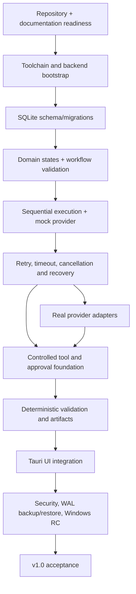

# AI Workflow Orchestrator — Release Risk Register

**Status:** Initial planning register; update at every release review.  
**Scoring:** Probability and impact use Low / Medium / High. Severity is a qualitative combined assessment, not a numerical score.

| Risk ID | Description | Affected release | Probability | Impact | Severity | Mitigation | Verification method | Owner decision |
|---|---|---|---|---|---|---|---|---|
| R-001 | Incorrect state transition or partial event/state commit corrupts execution history | v0.1–v1.0 | Medium | High | Critical | Central transition commands; atomic transactions; append-only event discipline | Exhaustive transition and rollback tests | No, unless source contract changes |
| R-002 | Crash or timeout after external side effect causes duplicate execution | v0.2–v1.0 | High | High | Critical | Persist operation intent; idempotency where meaningful; reconcile uncertain outcomes; never claim exactly-once | Crash injection and timeout-after-side-effect tests | No |
| R-003 | Retry policy repeats unsafe or non-idempotent operation | v0.2–v1.0 | Medium | High | Critical | Retry only classified transient safe operations; persist retry schedule; require reconciliation | Retry matrix and duplicate-side-effect tests | No |
| R-004 | SQLite WAL/backup handling loses or corrupts data on Windows | v0.1, v0.9 | Medium | High | Critical | Follow DB pragmas; test backup/restore and clean/active DB procedures on Windows | Windows WAL backup/restore test evidence | WAL test decision already confirmed |
| R-005 | Migration/schema design cannot support attempts, events, approvals or recovery | v0.1–v0.4 | Medium | High | High | Map DATABASE.md before migrations; version migrations; constraints and rollback tests | Fresh DB, upgrade and migration failure tests | No |
| R-006 | Unauthorized filesystem or process action escapes project boundary | v0.4–v1.0 | Medium | High | Critical | Canonical path checks; reject traversal/junction/symlink/ADS; executable allowlist; shell=False; bounded env/time/output | Adversarial path and subprocess tests | No |
| R-007 | Approval is reused or applied to changed action | v0.4–v1.0 | Medium | High | Critical | Canonical fingerprint; single-use; action binding; revalidate immediately before execution | Mutated args/target, stale and replay tests | No |
| R-008 | Hosted provider request unintentionally transmits local project data | v0.3–v1.0 | Medium | High | High | Explicit provider selection and disclosure; no silent fallback; minimize payload | Data-flow review and adapter tests | Provider choice required; transmission policy is specified |
| R-009 | Secret leaks through database, logs, exceptions, frontend or exports | v0.3–v1.0 | Medium | High | Critical | OS credential store; references only; centralized redaction; negative tests | Secret canary scan and log/error inspection | No |
| R-010 | Provider rate limits, outages or malformed responses destabilize execution | v0.3–v1.0 | High | Medium | High | Adapter normalization; timeouts; typed error classification; bounded retries only where safe | Contract tests for auth/rate limit/timeout/malformed response | Hosted provider selection |
| R-011 | UI and backend disagree about workflow/task status | v0.5–v1.0 | Medium | High | High | Backend authoritative; typed API client; polling from persisted state | Contract and end-to-end tests | No |
| R-012 | Local API is exposed to unintended local processes/origins | v0.1–v1.0 | Medium | High | Critical | Loopback binding, process token, Host/Origin validation, no wildcard CORS, private bootstrap | Unauthorized request and origin tests | No |
| R-013 | Windows packaging, lifecycle or upgrade behavior fails | v0.5–v1.0 | Medium | High | High | Early packaging spike within approved architecture; clean-install and upgrade test | Windows clean VM/install tests | Supported Windows baseline per source |
| R-014 | Agent governance documents contain stale references or overlapping instructions | Stage 0 | Medium | Medium | Medium | Keep AGENT_WORKFLOW process authority; RULES engineering authority; correct stale links only through approved docs change | Cross-reference and policy review | Existing governance decision accepted; cleanup review still required |
| R-015 | PRD §19 is mistaken for MVP scope and expands product/data/API surface | All | Medium | High | High | Explicitly classify deferred; SCOPE remains MVP gate | Traceability review against SCOPE P0-01–P0-10 | Deferred decision already confirmed |
| R-016 | Legacy technical-architecture.md is treated as competing authority | Stage 0–v1.0 | Medium | Medium | Medium | ARCHITECTURE.md canonical; SECURITY.md security authority; preserve legacy file pending reconciliation | Document authority audit | Owner review before edit/archive/delete |
| R-017 | SSE endpoint in API spec is implemented despite polling decision and scope deferral | v0.5–v1.0 | Medium | Medium | Medium | Polling through v1.0; SSE v1.1 candidate | API/UI scope audit | Polling decision confirmed |
| R-018 | Unapproved SDK/framework/infrastructure increases attack surface and maintenance | All | Medium | High | High | TECH_STACK registry; owner approval before install; no Redis/Kafka/Postgres/Docker runtime | Dependency inventory and diff review | Hosted SDK choice pending |
| R-019 | Test coverage threshold is invented or used as a misleading release gate | v0.1–v1.0 | Medium | Medium | Medium | Use behavior/critical-path evidence; ask owner to set numeric threshold if needed | Release checklist review | Threshold decision required only if numerical threshold is desired |
| R-020 | Repository local changes are overwritten because local Git status was not inspected | Stage 0/v0.1 | Medium | High | High | Run required Git status/branch/diff commands locally before any write | Captured command output in task record | No |

## 2. Critical path

## 3. Unresolved decisions and planning assumptions

| Decision ID | Topic | Current position | Required action | Blocks |
|---|---|---|---|---|
| D-001 | Hosted provider | Undecided by owner | Select one provider and approve official SDK/version; record in TECH_STACK.md | Hosted adapter in v0.3 |
| D-002 | PRD §19 | Deferred | Keep outside MVP; any admission requires formal scope change and updates to affected specs | No MVP work |
| D-003 | Live updates | Polling through v1.0; SSE v1.1 candidate | Keep API/UI polling; reassess only with measured need | No current blocker |
| D-004 | SQLite WAL | WAL with Windows backup/restore verification | Preserve test gate and report evidence at v0.9 | v0.9 release |
| D-005 | Tooling | Ruff and mypy approved | Use only versions/commands in TECH_STACK registry | v0.1 setup |
| D-006 | Agent governance | AGENT_WORKFLOW.md governs process | Apply accepted division; resolve stale references before relying on affected instructions | Stage 0 governance cleanup |
| D-007 | Architecture legacy document | ARCHITECTURE.md canonical; SECURITY.md security authority; technical-architecture.md retained pending reconciliation | Do not edit/delete legacy file without owner review | Any change relying on conflicting legacy content |
| D-008 | Coverage threshold | No numeric threshold asserted here | If desired, owner sets threshold; otherwise use critical-path and requirement evidence | No blocker |

## 4. Risk review cadence

At each release:
1. Re-score active risks based on observed test results.
2. Add newly discovered risks with evidence.
3. Link each high/critical risk to a test, mitigation owner and release gate.
4. Keep accepted residual risks explicit and attributable to the owner.
5. Block release on critical security/data-integrity failures unless the owner records an explicit, informed risk acceptance consistent with project policy.
