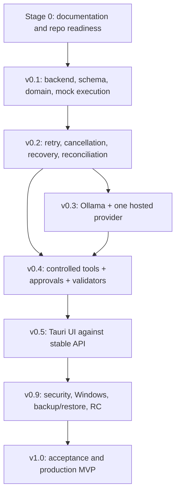

# AI Workflow Orchestrator - Release Roadmap

**Status:** Proposed planning baseline - owner review required  
**Repository:** `kumaradoss16/personal-projects/AI Workflow Orchestrator/`  
**Roadmap:** `v0.1 → v0.2 → v0.3 → v0.4 → v0.5 → v0.9 → v1.0`  
**Authority:** `SCOPE.md` controls MVP admission. This roadmap decomposes, but does not replace, the existing specifications.

## 1. Product delivery strategy

Deliver a local-first, single-user Windows desktop application using a backend-authoritative modular monolith. The product's MVP outcome is reliable sequential execution of structured AI workflows, with durable state, supported hosted/local inference, narrowly scoped developer tools, action-scoped human approval, deterministic validation, observable history, and restart recovery.

The critical sequence is:

1. Establish the application and persistence foundation.
2. Prove workflow definitions, state transitions, and sequential execution.
3. Establish recovery and safe retry semantics before real integrations depend on them.
4. Add provider adapters and controlled tools behind explicit interfaces.
5. Add approval enforcement and deterministic verification before exposing consequential tool actions.
6. Integrate the Tauri UI against stable backend contracts.
7. Prove security, data integrity, Windows installation, backup, and recovery before v1.0.

The release ladder is a delivery decomposition of `SCOPE.md` P0-01–P0-10. It does not change the scope or acceptance requirements in those milestones.

## 2. Governing architecture and constraints

- Modular monolith; no microservices or distributed execution.
- Python 3.12 + FastAPI backend; backend owns durable state, scheduling, authorization, providers, tools, persistence, and recovery.
- Tauri 2 + Rust + TypeScript 5 frontend; UI is presentation/control, never state or authorization authority.
- SQLite through Python standard-library `sqlite3`; local filesystem for project data and artifacts.
- Sequential task execution; validate workflow dependencies as a DAG, but do not execute tasks in parallel.
- Ollama plus one hosted provider; hosted provider and SDK remain undecided pending owner selection.
- Vanilla TypeScript by default; no UI framework without approval.
- Ruff and mypy are approved quality tools.
- Bounded retries and recovery must not claim exactly-once external effects.
- No automatic provider fallback, intelligent routing, unrestricted shell, unrestricted filesystem access, MCP, n8n, Docker runtime, DLQ, cloud control plane, or autonomous multi-agent execution in MVP.
- Polling is the approved live-update strategy through v1.0; SSE remains deferred.
- SQLite WAL is planned, subject to Windows backup/restore verification by v0.9.
- PRD §19 is deferred pending a separate scope decision.
- `AGENT_WORKFLOW.md` governs agent task procedure; `RULES.md` governs engineering standards.

## 3. Release overview

| Release | Objective | Principal deliverables | Exit criteria |
|---|---|---|---|
| v0.1 | Smallest durable execution foundation | Backend bootstrap, local API boundary, SQLite migrations, project/workflow/task records, state machine foundation, sequential mock-provider workflow, minimal CLI, tests | A three-task workflow executes in dependency order; durable state/attempt/event records survive restart; illegal transitions are rejected; fresh migrations and auth tests pass |
| v0.2 | Reliability and recovery foundation | Retry policy, persisted retry scheduling, timeouts, pause/resume/cancel semantics, leases/heartbeats, startup recovery, uncertain-outcome handling, consistency checks, redacted logs | Failure, retry, cancellation, crash/restart and uncertain-side-effect scenarios pass deterministic tests |
| v0.3 | Real inference providers | Provider contract, Ollama adapter, one owner-selected hosted provider and approved SDK, credential references, request/response/error normalization, data-transmission disclosure | Both configured provider paths pass success/failure/timeout tests; secrets are protected; no implicit fallback occurs |
| v0.4 | Controlled execution and verification | Project-scoped filesystem, read-only Git inspection, allowlisted test runner, approval queue/fingerprints/revalidation, deterministic validators, artifact integrity and execution evidence | Unauthorized/changed actions are denied; approval and tool operations are audited; validation evidence distinguishes SUCCEEDED from VERIFIED |
| v0.5 | Desktop application | Tauri shell, secure backend lifecycle/bootstrap, typed API client, functional screens from DESIGN.md, polling refresh, accessibility and UI states | Windows desktop can start/stop safely and complete core project/workflow/run/approval flows against real backend data |
| v0.9 | Release candidate and hardening | End-to-end regression, security review, WAL backup/restore verification, Windows packaging/install/upgrade tests, clean-clone CI, user docs, backup/export procedure | No unresolved release-blocking security/data-integrity defects; critical-path tests pass; clean install and recovery evidence exists |
| v1.0 | Production MVP | RC defect fixes only, final scope acceptance, release artifacts, known-issue and limitation record | Every applicable SCOPE.md §9 acceptance item is evidenced; no deferred feature is required to declare MVP complete |

## 4. Release detail and sequencing

### v0.1 - Core foundation

**Include:** Python backend skeleton; configuration/startup checks; loopback API and bootstrap authentication boundary; SQLite connection/migration infrastructure; initial project/workflow/run/task/attempt/event persistence needed by the first execution slice; validated workflow/task domain types; DAG validation; sequential scheduler; mock provider; deterministic transform; minimal CLI; API/idempotency contract needed for durable run creation; unit and integration tests.

**Exclude:** real Ollama/hosted calls, tool execution, approval queue, desktop UI, retries/recovery beyond the explicitly implemented initial single-attempt path, MCP, n8n, SSE, Docker, DLQ, parallel execution.

**User-visible result:** a developer can create a small workflow and run it through the mock provider using the minimal CLI, then inspect persisted state.

### v0.2 - Durable execution and recovery

Implement the remaining execution lifecycle semantics needed before external providers and tools are introduced: retry eligibility and scheduling, persisted `RETRY_WAIT`, timeouts, cooperative pause/cancel, leases/heartbeats, orphan detection, startup recovery, uncertain external-operation classification, `NEEDS_ATTENTION`, consistency checks, and redacted structured logs.

Do not claim exactly-once external execution. Retry only safe transient operations; side-effecting operations with uncertain outcomes require reconciliation rather than blind retry.

### v0.3 - Provider integration

Implement the provider-neutral adapter contract, Ollama integration, and exactly one hosted provider selected by the owner. The hosted provider SDK/version must be recorded in `TECH_STACK.md` before installation. Credentials use OS credential storage and persisted credential references, not plaintext database values. The UI/backend must make external data transmission explicit. Do not add intelligent routing or automatic local/hosted fallback.

### v0.4 - Controlled tools, approvals, and verification

Implement only the MVP tool set: project-scoped filesystem read/write, read-oriented Git status/diff/history, and explicitly configured project test/validation commands. Enforce canonical path boundaries, subprocess argument arrays, `shell=False`, sanitized environments, bounded execution/output, and approval policy. Approval is bound to a canonical action fingerprint, single-use by default, and invalidated by material action changes. Add deterministic validators and atomic artifact writes with SHA-256 integrity evidence.

### v0.5 - Desktop integration

Build the Tauri shell and TypeScript UI against stable `/api/v1` contracts. UI areas are limited to functional requirements in `DESIGN.md`: overview, project/workflow management, execution/task details, approvals, provider configuration, tool permissions/settings, history/logs/artifacts/validation. Use bounded polling, not SSE. Include real empty/loading/error/denied/unavailable states; no fake metrics or nonfunctional controls.

### v0.9 - Release candidate

Run full end-to-end, persistence, recovery, provider, tool, approval, security, API, UI and Windows packaging verification. Verify SQLite WAL backup/restore on Windows. Establish clean-clone CI and repeatable build/test instructions. Produce installation, configuration, permissions, limitations, backup and recovery documentation. Classify defects as release blockers or non-blocking improvements.

### v1.0 - Production MVP

No new feature work. Resolve release blockers, rerun the complete acceptance suite, verify every in-scope requirement, freeze dependencies and scope, publish release notes and known limitations, and produce the Windows release. A feature-complete UI without verified reliability/security evidence is not a production release.

## 5. Critical dependency path

Engineering work such as test design and documentation review can overlap where interfaces are stable; product workflow execution remains sequential.

## 6. Quality and release gate model

Every release must pass applicable functional, domain, persistence, API, security, static-analysis, automated-test, documentation, and packaging checks. Ruff and mypy are approved. pytest and pytest-asyncio are specified. No numerical coverage threshold is assumed unless an authoritative document specifies one; otherwise the owner must approve a threshold.

Gate statuses:

- `NOT_STARTED`: no implementation/evidence started.
- `IN_PROGRESS`: work or verification is active.
- `BLOCKED`: a dependency, conflict, failure, or approval prevents progress; blocker is recorded.
- `READY_FOR_REVIEW`: planned work and required evidence are complete and available for review.
- `APPROVED`: owner/reviewer explicitly accepts the release gate based on evidence.
- `RELEASED`: release artifact is produced and release record is complete.

A status cannot advance based on an agent assertion alone. Attach commands, test outputs, review decisions, and artifact references.

## 7. Scope boundary

**Required for v1.0:** all admitted capabilities in `SCOPE.md` §3 and P0-01–P0-10, including local project management, structured sequential workflows, durable execution, Ollama plus one hosted provider, restricted tools, backend-enforced approvals, deterministic validation, observability, recovery, and Windows desktop packaging.

**Deferred:** workflow templates/import-export, bounded parallel execution, additional providers, richer live updates/SSE, routing/fallback, MCP, advanced branching, multi-agent coordination, scheduling, visual graph editing, context retrieval/knowledge indexing, conversation integrations and collaboration, where supported by `SCOPE.md` §5.

**Explicitly excluded from MVP:** unrestricted shell/host access, cloud control plane/SaaS, distributed workers/microservices, MCP/n8n integrations, browser automation, multi-user collaboration, autonomous multi-agent execution, parallel/distributed task execution, vector database/RAG pipeline, enterprise SSO, Docker runtime requirement, DLQ, telemetry/analytics without approval.

**Owner decision required:** hosted provider/SDK selection; any PRD §19 scope admission; any change to the release ladder or exclusion list; any coverage threshold not specified in source docs.

## 8. Workstream ownership

The Python backend owns domain, execution, state, persistence, provider/tool invocation, approvals, and recovery. Tauri/TypeScript owns presentation and user interaction. SQLite repositories own persistence implementation; filesystem adapters own artifact storage. Provider and tool adapters isolate external interfaces. Security policy is enforced in backend application services, not UI controls.

## 9. Definition of v1.0 production readiness

The product is production-ready only within its documented local Windows/single-user boundaries when:
- all MVP acceptance checklist items in `SCOPE.md` §9 pass;
- state transitions and invariants are tested;
- persistence transactions, migrations, WAL, backup and restore are verified;
- crash/restart and uncertain-side-effect paths are tested;
- provider and tool failures are handled safely;
- approvals and project boundaries are enforced in backend code;
- secrets are not exposed in storage/logs/errors;
- UI displays real backend state;
- Windows install/startup/shutdown/upgrade behavior is verified;
- user-facing configuration, permission, limitation and recovery documentation is complete;
- release blockers are closed or explicitly rejected by the owner with documented risk acceptance.

## 10. Planning limitations

This roadmap is a proposed decomposition. It does not modify source specifications. Detailed route names, schema fields, state transition matrices, retry constants, security controls and design tokens remain defined by the authoritative domain documents. Where this roadmap does not restate a detail, the domain document remains controlling.
